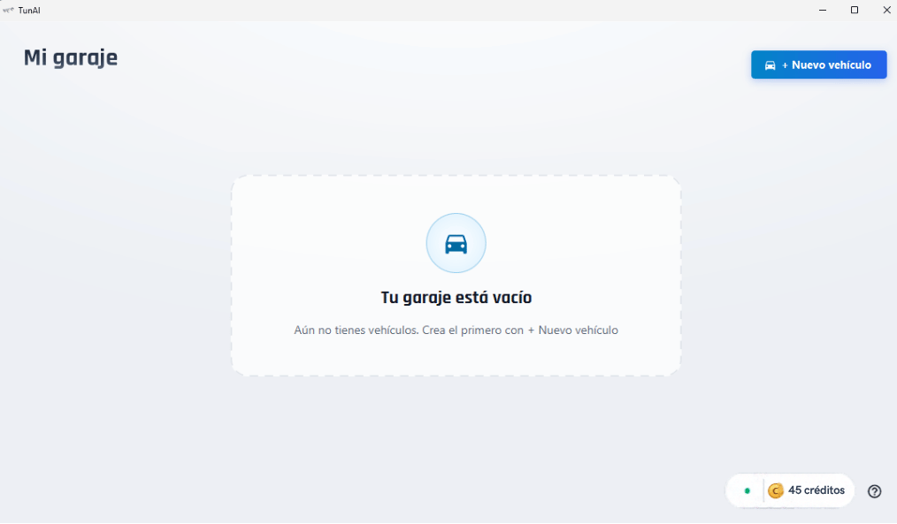
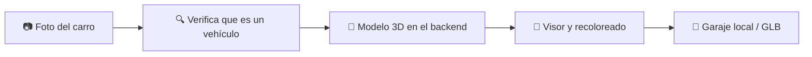

<p align="center">
  
</p>

<h1 align="center">TunAI Desktop</h1>

<p align="center">
  Toma la foto de un carro, obtén su modelo 3D, cámbiale el color y guárdalo en tu garaje.<br>
  App de escritorio en <b>JavaFX</b> para Windows, macOS y Linux.
</p>

<p align="center">
  <a href="https://github.com/ingmao021/tunAI-desktop/actions/workflows/ci.yml"></a>
  
  
  
</p>

<p align="center">
  
</p>

---



- 🧊 El modelo 3D lo genera el [backend de TunAI](https://github.com/ingmao021/tunAI-backend) con Tripo; la app no guarda ninguna clave.
- 🎨 Recoloreado de la pintura sin tocar rines ni interior, y exportación a `.glb`.
- 🚗 Garaje local: tus vehículos viven en tu equipo, sin cuenta ni inicio de sesión.
- 🔍 Un clasificador local (MobileNetV2, ONNX) rechaza fotos que no son de un vehículo.

## 🚀 Inicio rápido

Necesitas **JDK 21 o superior**. Maven no hace falta (trae `mvnw`).

```bash
git clone https://github.com/ingmao021/tunAI-desktop.git && cd tunAI-desktop

./mvnw javafx:run          # Windows: .\mvnw.cmd javafx:run
```

Por defecto usa el backend de producción. Para apuntar a uno local ([tunAI-backend](https://github.com/ingmao021/tunAI-backend), puerto 8080):

```bash
TUNAI_API_URL=http://localhost:8080 ./mvnw javafx:run
# Windows (PowerShell): $env:TUNAI_API_URL = "http://localhost:8080"; .\mvnw.cmd javafx:run
```

> [!WARNING]
> Cada generación exitosa gasta **créditos reales de Tripo** en el backend. Cada instalación tiene 45 créditos y cada modelo usa 15 (3 modelos); la app siempre pide confirmación antes de generar.

La URL del backend se resuelve así: `-Dtunai.api.url` → variable `TUNAI_API_URL` → `apiBaseUrl` en `settings.json` → producción.

## 📦 Instaladores

Descárgalos desde [**Releases**](https://github.com/ingmao021/tunAI-desktop/releases); incluyen Java, no necesitas instalarlo.

| Sistema | Archivo |
|---|---|
| Windows | `TunAI-<versión>.exe` |
| macOS (Apple Silicon) | `TunAI-<versión>.dmg` (sin firmar: la primera vez, clic derecho → Abrir) |
| Linux (Debian/Ubuntu) | `tunai_<versión>_amd64.deb` → `sudo apt install ./tunai_*.deb` |

Para publicar una versión basta con subir un tag (`git tag v1.0.4 && git push origin v1.0.4`): [`release.yml`](.github/workflows/release.yml) arma los tres instaladores.

## 🧪 Pruebas

```bash
./mvnw verify          # Windows: .\mvnw.cmd verify
```

Incluye pruebas de UI con TestFX que **abren ventanas**: no muevas el mouse mientras corren. El CI ([`ci.yml`](.github/workflows/ci.yml)) corre el mismo `verify` en Windows en cada push a `main` o `develop` y en cada PR. Los tests no llaman al backend real (usan un servidor HTTP falso).

## 🗂️ Datos locales

| Sistema | Carpeta |
|---|---|
| Windows | `%APPDATA%\TunAI\` |
| macOS | `~/Library/Application Support/TunAI/` |
| Linux | `$XDG_DATA_HOME/TunAI/` (por defecto `~/.local/share/TunAI/`) |

Ahí quedan `settings.json`, `installation-id`, el garaje (`garage\<id>\`) y los logs (`logs\tunai0.log`). Si el clasificador rechaza una foto válida, puedes desactivarlo en `settings.json`: `{ "classifier": { "enabled": false } }`.
